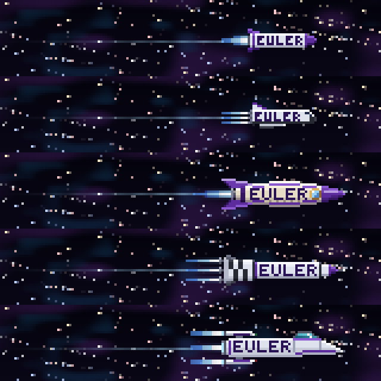

# eulerocket

A Claude Code mod that puts a pixel-art rocket marked **EULER** above your prompt, flying through
the stars. While Claude works the stars streak into warp, the rocket recedes into the distance and
its blue flame stretches; when a turn finishes, the ship glows. Prefer a space shuttle?
`/eulerocket ship shuttle` swaps it in. It runs in the terminal and in the desktop app, and costs zero tokens.

## Ships



The five ships you can pick with `/eulerocket ship <kind>`.


While Claude works the stars warp and the ship recedes; both are adjustable with `recede` and `blur`.

## Install

```
claude plugin marketplace add eduardoott/eulerocket
claude plugin install eulerocket@eulerocket
```

Then run `/reload-plugins` in Claude Code.

## Commands

Type `/eulerocket` to open the menu. In the terminal, press ctrl+x then tab to move into it; Esc
closes it. Every menu choice is also a command:

| Command | What it does |
|---|---|
| `/eulerocket` | opens the menu: pick the ship, show or hide, size, the band while working and idle, animation and pixels, with no arguments to type |
| `/eulerocket status` / `help` | the current settings and the list of commands |
| `/eulerocket on` / `off` | show or hide the rocket |
| `/eulerocket size <rows\|auto>` | band height, 2 to 24 rows |
| `/eulerocket slim <rows>` | band height in slim mode, 1 to 12 rows (default 4) |
| `/eulerocket working <slim\|full\|hide>` | the band while Claude works |
| `/eulerocket idle <full\|slim\|hide>` | the band while Claude is idle |
| `/eulerocket pixels <standard\|fine>` | fine: four pixels per character, for tight line spacing |
| `/eulerocket colormode <auto\|full\|256>` | 256 for terminals without true colour |
| `/eulerocket animate <on\|off>` | hold the scene still |
| `/eulerocket recede <0\|30\|45\|60\|75>` | how far the ship recedes while Claude works, in percent of its size (default 30; 0 turns it off) |
| `/eulerocket blur <0\|25\|50\|75\|100>` | how soft the ship gets when it shrinks: 100 smooth (default), 0 crisp pixels |
| `/eulerocket ship <kind>` | which ship flies: `rocket` (classic rocket marked EULER), `shuttle` (space shuttle), `retro` (1950s retro rocket), `staged` (multi-stage rocket with escape tower) or `scifi` (starship with blinking lights, default); the large detailed versions show when the band is 8 rows or more |
| `/eulerocket demo <working\|done\|error\|intro>` | play an effect |

## Development

- `bun tools/preview.ts` regenerates the images in `docs/img/`.
- `bun tests/menu.test.ts` runs the menu tests.
- `bash tools/validate.sh` validates the plugin.

## Credits

Adapted from [pixelband](https://github.com/furqan-khan07/pixelband) by Furqan Khan, under the MIT
licence. The rendering engine (raster, effects, colours) is his; the rocket scene is new.
